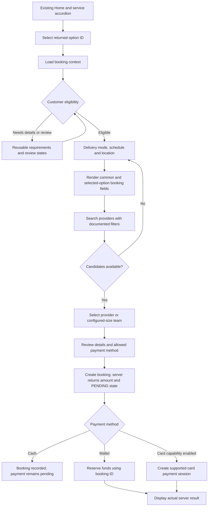

# Customer provider-search and booking: FigJam assessment

Reviewed on 2026-10-22. The documented search, explicit provider selection,
booking and supported payment stages are now implemented. See
[customer-booking.md](customer-booking.md) for delivered behavior, validation,
map configuration and the remaining backend gaps. The assessment below records
the FigJam requirements and their API boundaries.

## Evidence and authority

- Supplied board: `C:/Users/hjana/Downloads/Bthere Figjam.pdf`.
- PDF SHA-256: `5C3F04C6738CB715FB3FE9313FCA82DAC33B237F1C9B38B8CDF1E05D66AA5454`.
- Original board link: https://www.figma.com/board/fFW5Q7Nhqr41vm1LG1SqJK/Bthere-Figjam?node-id=2-73.
- API contract: supplied Customer frontend reference in attachment
  `481b13c7-d999-4573-9362-10143874247b/Pasted text.txt`, especially sections
  17–33, 34, and the Wallet/payment API addendum.
- Current client: Customer discovery repository/controller, Home, service
  accordion and per-account persisted market selection.

The PDF is one large 9504 × 6148-point board with 19 placed screenshot images,
18 unique embedded images, four textual branch captions and connecting arrows.
The screenshots were extracted and visually inspected; one provider-results
image is reused in two branches. Three matching/confirmation screenshots are
only 213 × 462 pixels in the source PDF, so their smallest text is not a reliable
source for additional field requirements. Rendered overview, original-resolution
screens and extracted captions are in ignored `build/figjam-review/`.

The board describes intended UX. The supplied API document defines the current
wire contract. Neither a pictured control nor a branch caption proves that a
backend endpoint/feature exists. No live authenticated booking was attempted.

## Observed board flow

1. Branded Home → expandable category/sub-service list.
2. Map with selected sub-service, location/radius, date, preferred time and
   duration. Some branches show a gender preference or gender-specific counts.
3. Service-specific details: Patient Care shows hospital address, ward, bed and
   optional notes; Physiotherapy shows address and optional notes without
   ward/bed. Selected time/duration is summarized.
4. Direct-selection branch shows provider markers and cards with name, photo,
   rating, chips and Select. The Event Crew branch shows counts, gender tabs and
   Send Invite actions.
5. Branches converge on a payment screen with a displayed price and card,
   eZ Cash and cash choices. Additional screens show saved cards and Add Card.
6. Payment success → finding a caregiver → caregiver found with a 30-second
   automatic-confirmation/cancel window → selected caregiver, arrival estimate,
   Home and messaging actions.

Explicit branch captions:

| Board branch | Configuration shown | Contract assessment |
| --- | --- | --- |
| Patient Care open request | TIME_BASED, location required, one provider/one customer, provider → customer | Time/location search exists. Automatic open dispatch and acceptance do not. |
| Patient Care direct request | TIME_BASED, location required, one provider/one customer, provider → customer | Search and explicit provider booking are supported. |
| Physiotherapy direct request | TIME_BASED, location required, one provider/one customer, customer → provider | Use a returned fixed provider location. The pictured address alone does not establish the correct payload. |
| Event Crew open request | TIME_BASED, location required, many providers/one customer, provider → customer | Configured team size and explicit provider IDs exist; invitations, automatic matching and gender quotas do not. |

Service names, dates, nearby counts, provider profiles, sample prices and the
radius in these images are illustrations, not client defaults or fixture data
to ship. Do not infer a required hospital field from the name Patient Care.

## Implementable customer journey

The board's payment-before-automatic-matching ordering cannot be reproduced
with the current API: final booking already requires selected provider IDs.
There is no supported client-only shortcut around that requirement.

## Backend-driven forms and field ownership

Load `GET /customers/me/booking-context` with `marketId`, `serviceTypeId` and
`optionId`. Use returned `selection`, `bookingSchema`, responsibilities,
`matchingFilters`, timezone and supported capabilities.

Keep these data categories separate:

| Data | Source | Destination |
| --- | --- | --- |
| Delivery/schedule/location configuration | Selected option and delivery configurations | Documented search and booking fields |
| Reusable customer identity/evidence requirements | `GET /customers/me/requirements?serviceTypeId=…&optionId=…` | Requirement submission PUT: `requirementId`, typed `value`, optional `expiresOn` |
| Per-booking service questions | `bookingSchema.commonFields` plus selected option's `fields` | Booking `answers`: `{fieldId, value}` |
| Provider qualifications | Provider `serviceSetup` sections | Display relevant context only; never ask the customer to submit provider certificates/education |
| Search matching preferences | Documented `matchingFilters` | `languages`, `requiredSkillIds` only |

Reusable submission PUT uses `/customers/me/requirement-submissions`, with a
`submissions` array containing those entries; eligibility is read
from `/customers/me/eligibility` with the same service/option context. Effective
submission status, rejection/expiry and blocking reasons must remain visible.

For booking questions, deduplicate by field ID; retain code/version for schema
state; follow active definitions, labels, required flags and display ordering.
Support TEXT, TEXTAREA, NUMBER, BOOLEAN, DATE, TIME, PHONE, EMAIL, SELECT,
MULTI_SELECT and configured private upload fields. Keep JSON numbers/booleans
typed: `0` and `false` are valid answers. Choice objects submit their `value`,
not their display label.

Apply only documented EQUALS/NOT_EQUALS conditions against another booking
field's code, using typed JSON comparison. A missing parent means the child
does not apply. Clear hidden dependent answers when their parent changes and
exclude inactive/nonapplicable values from submission. Unknown field types or
condition operators must produce an understandable unsupported-schema state;
never silently submit a supposedly complete form.

Ward/bed/hospital-specific notes are rendered only if returned as booking fields
with real field IDs. A generic note may use documented `customerNote` when the
product intends a generic note; do not silently remap configured field answers
into that property. The pictured 200-character note limit is not a universal
backend rule. Do not fabricate validation limits absent from the definitions.

Private uploads use `/uploads/documents` and return private keys. Answers carry
`files: [{key: …}]`, not bytes or public photo URLs; signed view URLs are for
viewing. Enforce returned count/type/size limits and supported private formats.

## Schedule, location and search

- `TIME_BASED`: require future start/end with a positive interval, at most 31
  elapsed days. Search uses offset timestamps `startAt`/`endAt`; booking uses
  offset-free `startDatetime`/`expectedEndDatetime` in the market's IANA timezone.
  Do not strip a device-local offset to approximate market time. Reject invalid
  or ambiguous DST intervals according to the documented backend restrictions.
- `PROVIDER_TO_CUSTOMER`: search around customer coordinates; booking includes
  a valid meeting point/address. Travelling provider pins are approximate service
  coverage centres, not current GPS positions.
- `CUSTOMER_TO_PROVIDER`: search fixed public provider locations; retain the
  selected candidate's `providerLocationId` and send it at booking. Do not use
  a meeting point or another provider's location ID in its place.
- `ONLINE`: omit physical coordinates/meeting point/provider location and show
  a list rather than physical provider pins.
- `ROUTE_BASED`: the PDF does not demonstrate this branch. The API already
  documents pickup/destination and pickup time, no search `location`/`endAt`,
  server-derived route end and address-bearing booking route points. Plan it
  separately; current estimates are straight-line, not road ETAs.
- `radiusKm` is configurable input in the documented 0.1–500 range; do not
  hardcode the pictured 5 km. A useful initial value is a product decision.
- No `ASAP` scheduling enum or immediate-dispatch contract exists. Do not send
  an invented immediate flag from the pictured Immediate chip.

Search: `POST /customers/me/provider-search`. Send only documented IDs, mode,
timestamps, applicable location shape, radius, languages, skill IDs and pagination.
Do not include gender, arbitrary booking answers, payment method, provider IDs
or eligibility overrides. All requested languages and skills are AND-combined.

Results use real `totalCandidates`, `hasNext`, page and candidates. Counts are
provider-location results, not necessarily distinct people or online providers.
For teams, `NO_AVAILABLE_PROVIDERS` can have a positive total but no candidates
when there are insufficient distinct people. Reset page, selection and results
after context changes; ignore late responses. Deduplicate by provider/location
key for results, by provider ID for team membership.

Map pins must respect `locationLabel` and nullable map points. Use returned names,
photos, rating/count, languages, distance and capacity. Null ratings remain unrated.
Candidate responses do not supply arbitrary skill chips, gender, live presence,
contact details or verified/background-checked badges. The board's green dots
must not be presented as online state. Map SDK configuration, GPS permissions and
manual address/geocoding fallback require separate frontend integration.

## Selection, booking and payment differences

| Pictured behavior | Current contract | Implementation decision |
| --- | --- | --- |
| Male/Female provider filter and counts | No gender search property or candidate gender | Needs backend extension; do not infer gender from name/photo or post-filter fabricated data. |
| Event Crew counts by gender | `requiredProviderCount` is configured; booking needs that many distinct provider IDs | Support configured-size explicit team selection; do not translate gender counts into skill IDs or dynamic answers to claim matching. |
| Send Invite / automatic OPEN_REQUEST | No dispatch/invitation/acceptance routes | Needs backend work; do not present automatic matching as operational. |
| Direct selection | Search returns provider IDs and optional location IDs | Supported; final booking rechecks capacity. No reservation exists at selection time. |
| Rs. 3,000 per person / Rs. 5,000 before booking | No customer price-preview endpoint; server computes amount at booking | No invented quote, unit rate or locally multiplied team price. Review may explain that server amount is determined on creation. |
| Service fee + platform fee breakdown | Booking response has expected amount/currency, no documented breakdown | Display returned total only; needs backend quote/breakdown contract for those separate rows. |
| Select cash, then Payment Successful | Created cash booking has pending payment | Show booking recorded/payment pending; never claim paid. |
| Saved-card brands, expiry, default/edit/delete | Current method setup/list is synthetic with method ID/type/display label/status only | Show only supported server fields and capabilities; no fabricated card management. |
| Add Card: PAN, cardholder, expiry and CVV | Mock setup has no request body; no hosted/tokenized setup | Do not collect real card credentials into this form. Needs real payment integration for that design. |
| Card payment with a chosen saved method | Current booking card-session has no body/methodId | Do not invent a method-selection payload. |
| eZ Cash gateway success | Configured payment enum is not an implemented gateway | No claim that eZ Cash/KOKO/bank-transfer collection works merely because its enum is allowed. |
| Payment success confirms provider | Payment, booking creation and provider acceptance are different states | Show actual server states independently. |
| 30-second auto-approval/cancel | No documented customer acceptance/cancellation/timer API | Needs backend contract; no fake timer/state transitions. |
| Arrival 15–20 min / caregiver on the way | `liveTrackingSupported:false`; no arrival/presence stream | Needs backend tracking/ETA contract. |
| Message caregiver | No documented customer messaging API in supplied reference | Keep unavailable until supported. |
| Experienced/verified/background-checked/friendly badges | Not in search candidate schema | Do not assert these qualities based on the mockup. |

Final creation: `POST /customers/me/bookings`, using actual service/option/provider
IDs, supported mode/time/location, typed booking answers, optional customer note
and an allowed payment method. Do not add client amount, approval flags or a
marketId property absent from this booking request contract. A 201 response
returns a real `jobId`, server price/currency and current statuses; PENDING is
not payment success or provider acceptance.

For checkout, intersect option methods with `GET /me/payment-settings`
capabilities. WALLET reserves the existing booking's amount via
`POST /customers/me/bookings/{jobId}/wallet-payment`; RESERVED is not settled.
CARD uses `POST /customers/me/bookings/{jobId}/card-payment-session` with its
required Idempotency-Key and no body. Current card processing is MOCK only;
mock success is test functionality, not a real payment promise. These payment
routes take the server booking amount, not a client price override.

A booking POST timeout is an uncertain outcome. Do not automatically POST again:
there is no booking idempotency contract. Read `GET /customers/me/bookings`,
show existing records and seek reconciliation before a user-initiated retry;
do not pretend heuristic history matching proves whether an ambiguous attempt
was created. Search itself is safe to retry. No single-booking detail GET or
generic customer cancellation endpoint is documented.

## Step-by-step implementation milestones

1. **Booking context and journey state.** Replace the current sub-service
   coming-next sheet with a gated journey route. Fetch and type context, expose
   configuration and responsibilities, handle stale/invalid IDs and eligibility.
   Keep market/service/option identity together and invalidate derived state
   when any of them changes.
2. **Reusable requirements and dynamic booking form.** Separate requirement
   submission/review from per-booking answers. Build the typed field renderer,
   conditions, validation, uploads and draft behavior. Render admin-configured
   fields without per-service hardcoded forms. This is the recommended first
   functional UI milestone alongside context loading.
3. **Schedule and location.** Implement TIME_BASED + DIRECT_REQUEST for supported
   returned delivery modes first, then ONLINE/fixed venue as configured; add
   timezone-safe input and map/manual location handling. Keep unsupported
   prototype-only controls unavailable with clear wording.
4. **Provider results and explicit selection.** Add paginated search, genuine
   candidate cards/map labels, empty/error states and stale-response guards.
   Begin with one provider, then configured team size. A candidate details sheet
   may show returned search fields; do not invent a full provider-profile API.
5. **Review, final booking and history.** Submit the exact DTO, show server price
   and statuses, map changed availability and reconcile uncertain timeouts.
   Add real recent bookings/history rather than the current Home placeholder.
6. **Capability-gated checkout.** Cash status display, wallet reservation and
   explicitly labelled mock Card flows using current APIs. A real gateway and
   card tokenization require additional backend/payment integration.
7. **Additional configured branches.** Add ROUTE_BASED using its separate API
   shape. Automatic dispatch/invites, gender matching, flexible gender-count
   teams, live tracking, cancellation and messaging wait for confirmed contracts.

Suggested app-local ownership: `features/booking/domain` for typed context,
fields and journey state; `data` for context/requirements/search/booking adapters;
`application` for lifecycle, invalidation and race protection; `presentation`
for the map/sheets/form renderer. Put a widget in the shared Design System only
when both apps actually need the same presentation primitive.

Acceptance coverage should include context switches, unsupported schema, typed
false/zero answers, conditional clearing, rejected/expired/review requirements,
time zones/DST, all location shapes, empty/insufficient-team search, nullable
media/ratings, pagination duplicates, stale availability, secure-session refresh,
upload failures, double-tap prevention, payment-state distinctions and uncertain
booking outcomes. Verify actual deployed responses during implementation; this
assessment is grounded in the supplied reference rather than a live API audit.

No app behavior, API contract, dependencies or native configuration was changed
for this review. PDF tooling and extracted reference images remain in temporary
or ignored build directories. No commit, push or PR was performed.
