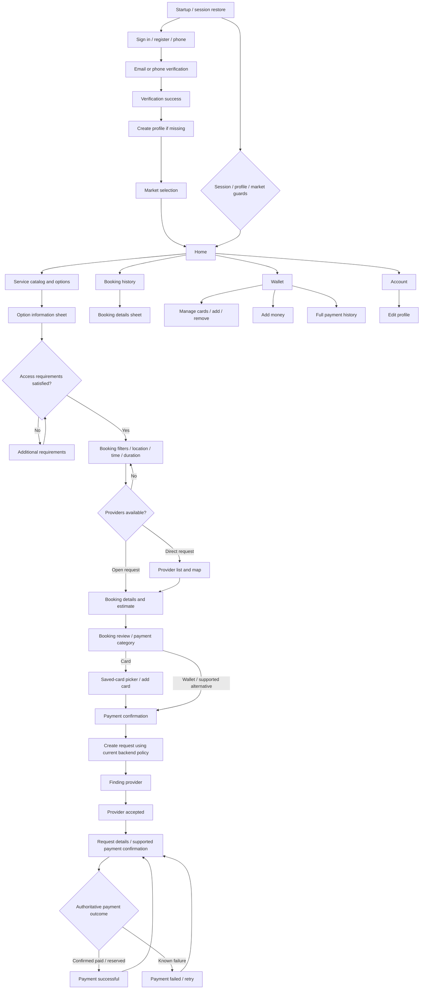

# Customer UI inventory and enhancement map

Code audit: 2026-10-30. This is an inventory of implemented views, not a visual quality approval. The user reports testing customer booking creation through provider acceptance successfully with another tester. This document does not claim that every payment outcome was verified live.

## How to use this inventory

Each ID is a review unit. Several units share one route or widget. Improve one unit at a time, including its loading, empty, error, validation and success states. Status starts as **Pending review** for every implemented unit; implementation already exists.

Before changing a unit, capture its current appearance, agree on its reference and scope, then implement and compare on a device. Record approval here before moving to the next unit. Existing booking rules and backend contracts remain the baseline.

## Screen and overlay inventory

Paths below are relative to `apps/customer_app/lib/`.

| ID | Implemented UI | Entry / implementation | Type |
| --- | --- | --- | --- |
| A01 | Startup / session restoration | `/`, `app/customer_app.dart` | Page/state |
| A02 | Email sign in | `/auth`, `features/auth/presentation/customer_auth_screen.dart` | Page variant |
| A03 | Email registration | Same auth screen | Page variant |
| A04 | Phone sign in / OTP request | Same auth screen | Page variant |
| A05 | Email OTP verification | `features/auth/presentation/customer_verification_page.dart` | Page variant |
| A06 | Phone OTP verification | Same verification page | Page variant |
| A07 | Verification success | `/verification-success` | Page |
| P01 | Create customer profile | `/profile`, `features/profile/presentation/customer_profile_screen.dart` | Page variant |
| P02 | Edit profile / photo | Same profile screen, existing-profile mode | Page variant |
| P03 | Account / session actions | `/account`, `app/customer_app.dart` | Page |
| P04 | Sign-out confirmation | Account page | Dialog |
| D01 | Market selection | `/market`, `features/discovery/presentation/customer_market_screen.dart` | Page |
| D02 | Home | `/home`, `features/discovery/presentation/customer_home_screen.dart` | Page |
| D03 | Service catalog / search / expanded options | `/services`, `features/discovery/presentation/customer_services_screen.dart` | Page |
| D04 | Service option information / access reasons | Service catalog option action | Bottom sheet |
| B01 | Additional service access requirements | Booking access-gated branch, `features/booking/presentation/customer_booking_screen.dart` | State/form |
| B02 | Booking filters, schedule, duration and availability | `/booking/:service/:option`, `BookingStage.details` | Map + sheet |
| B03 | Location search, suggestions and map selection | `booking_location_dialog.dart`, `booking_location_picker.dart` | Picker/dialog |
| B04 | Radius selection | Booking screen `_chooseRadius` | Bottom sheet |
| B05 | Date, time and custom duration selection | `booking_schedule_picker.dart` | Picker/dialog |
| B06 | Available providers / provider selection | `BookingStage.results`, `booking_provider_results_canvas.dart` | Map + sheet |
| B07 | Dynamic booking details / pricing choices / estimate | `BookingStage.serviceDetails` | Map + form sheet |
| B08 | Booking review / payment category selection | `BookingStage.review`, `booking_review_summary.dart` | Map + sheet |
| B09 | Saved-card selection | `booking_saved_cards_dialog.dart` | Dialog |
| B10 | Payment confirmation / amount / chosen method | Review's `_paymentConfirmation` variant | Map + sheet |
| B11 | Finding a provider | `booking_request_progress_screen.dart`, MATCHING | Full-screen state |
| B12 | Provider accepted / confirmation deadline | Same progress screen, AWAITING_CUSTOMER_CONFIRMATION | Full-screen state |
| B13 | Created booking / request details and payment actions | `BookingStage.created`, booking screen `_created` | Receipt/state |
| B14 | Payment successful | `booking_payment_result_screen.dart` | Full-screen state |
| B15 | Payment failed / retry / change method | Same payment result screen | Full-screen state |
| B16 | Cancel request / change payment confirmation | Booking screen confirmation actions | Dialogs |
| H01 | Booking history | `/bookings`, `features/booking/presentation/customer_bookings_screen.dart` | Page |
| H02 | Historical booking details | `BookingHistoryTile` tap | Bottom sheet |
| W01 | Wallet overview, balance, saved cards and recent transactions | `/wallet`, `features/wallet/presentation/customer_wallet_screen.dart` | Page |
| W02 | Manage saved payment methods | Wallet Manage | Bottom sheet |
| W03 | Add new card / validation / brand detection | `features/wallet/presentation/add_test_card_dialog.dart`; reused in booking | Dialog |
| W04 | Add money / amount / method / test payment progress | `features/wallet/presentation/add_money_sheet.dart` | Bottom sheet |
| W05 | Full payment history | Wallet View all | Bottom sheet |
| W06 | Saved-card actions / remove | Wallet `_savedCard` action menu | Menu/action |
| S01 | Missing runtime configuration | `/configuration`, `app/customer_app.dart` | Utility page |

Review shared UI once, then verify its use on every affected screen:

| ID | Shared component | Source / scope |
| --- | --- | --- |
| C01 | Typography, colors, spacing, corners, controls | `app/customer_theme.dart`; existing customer design-system documentation |
| C02 | Branded top bar / avatar / notification action | `app/widgets/customer_top_bar.dart` |
| C03 | Bottom navigation / selected and unselected icons | `features/discovery/presentation/customer_bottom_navigation.dart` |
| C04 | Map overlays, service dropdown, provider count, recenter | Booking presentation canvases and dropdown |
| C05 | Form fields, inline required highlighting and dynamic icons | Booking dynamic fields and validation groups |
| C06 | Amount summaries, payment rows, card brands and primary actions | Booking and wallet presentation |
| C07 | Loading, empty, unavailable, permission and retry messages | Cross-screen states; avoid exposing raw server errors |

## Current navigation map



This map emphasizes the scheduled request flow. Legacy booking/payment branches remain in code and need separate regression coverage when their UI is touched. Payment success requires authoritative backend confirmation; provider acceptance alone is insufficient. The proposed pre-match hold/preauthorization flow and automatic approval still require a backend contract. A backend-supplied deadline is not an automatic charge instruction.

## Visible actions without implemented destination screens

- Opportunities and Messages bottom tabs currently show coming-soon snackbars.
- The notification action currently shows a coming-soon snackbar.
- Recurring services are advertised as coming soon on Home.
- Historical booking details do not provide live tracking or cancellation. Unpaid active-request cancellation in the booking flow is a separate implemented action.

These are not completed screens and should not be included in the UI enhancement completion count. Implementing them is separate functional work.

## Recommended enhancement order

1. **Shared baseline (C01–C07):** agree on typography, compact spacing, field/button sizes, map overlays and feedback. Preserve existing Figma assets and shared header/footer.
2. **Main entry journey (D02, D03, D04):** Home, services, service options.
3. **Booking in journey order (B01–B16):** filters, pickers, provider choice, details, review, cards, payment, matching, acceptance and outcomes. Cover both open and direct requests.
4. **Bookings (H01–H02):** history and details.
5. **Wallet (W01–W06):** overview, methods, card entry, add money and transactions.
6. **Identity and setup (A01–A07, P01–P04, D01, S01):** auth, verification, profile, market and utility states.
7. **Consistency pass:** revisit complete journeys on a physical device and resolve differences across screens.

Start with C01 and D02 as the first concrete review. Avoid redesigning all screens in one change. Shared component changes must be checked in both booking and wallet before approval.

## Review record template

Copy this record for each unit as work starts:

```text
UI ID / name:
Status: Pending review | Reference agreed | Implementing | Device review | Approved
Current screenshot:
Target reference / agreed changes:
States checked: normal / loading / empty / error / validation / disabled
Layout checks: small phone / keyboard open / long content / larger text / safe areas
Functional checks: navigation / back / existing selections retained
Validation performed:
Remaining issues:
User approval:
```

Use existing focused widget tests for touched interactions. Add coverage for changed behavior or a real layout regression; avoid duplicating tests for every cosmetic spacing change. No implementation or live backend behavior was changed by this audit.
