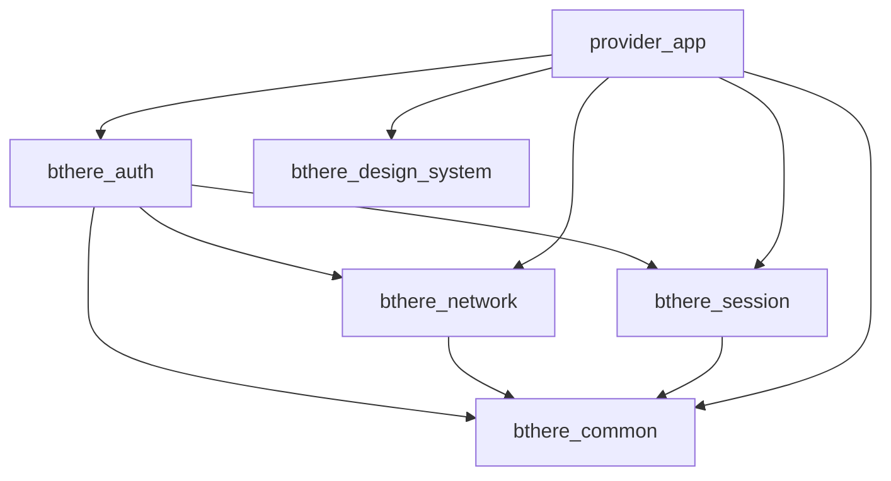

# B there mobile architecture

## Two apps in one repository

B there is a two-sided service marketplace. Customer and Service Provider are
separate Flutter applications with separate executables, release lifecycles,
and user experiences. They must not become one app with role switching.
The monorepo lets developers coordinate genuinely shared infrastructure and
compatible dependency versions while keeping each application's business logic
inside its own app. Dart Pub Workspaces provides one dependency resolution.

`apps/` owns app composition and role-specific features. `packages/` owns only
reusable infrastructure needed by both apps. Provider onboarding belongs in
`provider_app`; Customer booking flows belong in `customer_app`.

This document establishes boundaries and intended future organization. Common
result/failure primitives, secure session persistence, REST transport, and the
four confirmed Provider auth operations and Provider bootstrap are implemented.
The shared Design System is implemented; Customer remains a scaffold. The conceptual feature folders below have not
been created. See the foundation document for current implementation details.

## Shared package responsibilities

| Package | Future responsibility | Restrictions |
| --- | --- | --- |
| `bthere_common` | Small shared value types, non-UI utilities, generic result/error types where appropriate, and truly shared constants. | Lowest common dependency. No higher-level workspace dependency, networking, token storage, authentication implementation, Flutter UI, or role-specific logic. |
| `bthere_design_system` | Colors, typography, spacing, shapes, buttons, form controls, cards, and loading/error visual components. | No auth, network, session, or app dependencies. UI must not know API implementation details. |
| `bthere_session` | Authenticated session model, access/refresh token persistence, secure storage abstraction, clearing/restoration, and expiry metadata. | May depend on common only among workspace packages. No network, auth, design system, or app-specific features. |
| `bthere_network` | HTTP infrastructure, request configuration, interceptors, error normalization, multipart infrastructure, and REST transport. | May depend on common only among workspace packages. No auth, session, design system, or application feature dependencies. |
| `bthere_auth` | Shared authentication domain/repository infrastructure, shared register/login/OTP/token-refresh behavior, and shared auth DTOs/models where appropriate. | May depend on common, network, and session. No app or design system dependency. Provider onboarding remains in the Provider app. |

`bthere_common` and `bthere_network` are pure Dart packages using Dart lints and
`package:test`. Design System and Session remain Flutter-capable for future UI
and plugin integration. Auth remains Flutter-capable through Session but has no
UI. See the [foundation technology plan](foundation-technology-stack.md).

## Dependency directions

An arrow means "depends on". The currently configured workspace edges are:



Each dependency uses `^0.0.1`, compatible with the local package version `0.0.1`.
Normal Pub Workspace resolution selects those local members; no filesystem
path dependencies or dependency overrides are needed.

Both apps may depend on any shared package when their composition or features
actually use it. Provider now depends directly on Auth, Network, Session, Design System, and Common;
Customer currently declares no shared-package dependencies.
Design system currently declares no workspace dependency; a genuinely needed
common dependency may be considered later. Shared packages never depend on an
app, and the two apps never depend on each other.

Forbidden directions include network to auth/session, session to network/auth,
design system to auth/network/session/apps, and common to any higher-level
workspace package. Auth must never depend on either app. These rules prohibit
network → auth → network, session → network → session, and
design system → app → design system cycles.

Circular dependencies couple packages' initialization and changes, make
isolated testing harder, and blur which layer owns a responsibility. Keep the
graph acyclic. Future network token/session integration must use an abstraction
or a dependency supplied by the application's composition layer. Do not add a
direct network-to-session/auth dependency to obtain credentials.

The pubspecs express the current graph. Future edits and imports must be reviewed
against these boundaries; this task adds no automated boundary enforcement.

Network owns Dio only and remains pure Dart. NetworkConfig receives its base URL
from composition. AccessTokenProvider supplies credentials through inversion of
control without a Session dependency. Authentication is explicit per request.
ApiClient normalizes DioException into safe NetworkException; repositories map
transport errors into AppFailure/Result. There is no automatic refresh, mutation
retry, or sensitive HTTP logging. The foundation document details request and
backend error extraction behavior.

Auth now owns Provider email registration, email verification, phone OTP request,
and phone OTP verification only. Registration/request do not create a session.
Verification validates the Provider role and persists credentials before returning
safe AuthUser metadata. Public requests never require a token-provider bridge.
AuthUser does not contain tokens or Provider profile/onboarding state. Login,
resend, refresh, logout/logout-all, and other auth methods are deferred until the
current backend contracts are confirmed. See the foundation document for parsing,
clock injection, local validation, and safe failure mapping details.

Provider uses Riverpod for composition and go_router for stable startup/auth/Services routing. Configuration comes only from BTHERE_API_BASE_URL; invalid configuration or secure-storage failure remains an explicit startup failure. Valid restored credentials and login land on `/services`. Expired credentials are retained for future refresh but never supplied to Network.

Service-first UX lives in `features/services`. It reuses Provider onboarding data/domain layers for catalog, assignment, schema, options, completion, profile and markets. Each main service owns its assignment identity, numeric experience, persisted sub-services, filtered requirements and product status. Completion nextStep is parsed as backend state but does not drive a global navigation wizard. Shared documents remain satisfied according to backend completion; no global document collection or new upload contract is introduced.

See [Provider service-first architecture](provider-service-first.md). Requirement forms and token refresh remain deferred.

## Feature-first applications

Feature-first means grouping a capability's UI and data code together, rather
than placing every screen or repository from the whole app in one directory.
`app/` will compose the application and its dependencies. `core/` will hold
app-local foundations shared by features, without becoming a dumping ground.

Provider owns profile, onboarding, service assignments/options, languages,
availability, service areas, skills, documents, qualifications, dynamic
requirements, completion/approval, and later job requests, active jobs, and
earnings. Its conceptual future structure is:

```text
lib/
├── app/
├── core/
└── features/
    ├── auth/
    ├── onboarding/
    ├── profile/
    ├── services/
    ├── availability/
    ├── service_areas/
    ├── skills/
    ├── documents/
    ├── qualifications/
    ├── dynamic_requirements/
    ├── completion/
    ├── home/
    ├── job_requests/
    ├── active_job/
    ├── job_history/
    ├── earnings/
    └── settings/
```

Customer owns service/provider discovery, booking, active bookings, payments,
ratings, and Customer profile. Its conceptual future structure is:

```text
lib/
├── app/
├── core/
└── features/
    ├── auth/
    ├── home/
    ├── services/
    ├── provider_discovery/
    ├── booking/
    ├── active_booking/
    ├── booking_history/
    ├── payments/
    ├── ratings/
    ├── notifications/
    ├── profile/
    └── settings/
```

## Layers inside a feature

The intended flow is:

```text
Presentation
    ↓
ViewModel / Controller
    ↓
Repository
    ↓
Remote / Local Data Source
```

Presentation displays state and captures user actions. A ViewModel or Controller
coordinates UI state and calls repositories. A repository provides the feature's
data operations and reconciles remote responses with appropriate cached data.
Remote/local data sources handle transport or persistence details. Screens
should not directly manage HTTP requests or token storage.

An illustrative future Provider feature, not created yet:

```text
features/availability/
├── data/
│   ├── models/
│   ├── services/
│   └── repositories/
└── presentation/
    ├── view_models/
    ├── screens/
    └── widgets/
```

## Backend and local data ownership

The backend remains authoritative for account state, Provider approval, service
assignment state, bookings/jobs, payments, earnings, availability configuration,
service approval status, and marketplace operational state. Local storage must
not become an independent source of truth for critical business state.

Local persistence will serve secure auth sessions, preferences, caches, and safe
resumable UI state where appropriate. A draft or remembered screen cannot prove
that a booking exists, a payment succeeded, or a Provider was approved.

Use cached reads where appropriate: display previously fetched information with
clear freshness expectations, then refresh from the backend. Use online-first
writes for business operations: send the change to the backend and treat its
accepted response as authoritative. When offline or a request fails, show a
pending/error state rather than recording critical business success locally.
Do not silently queue marketplace mutations without a later explicit design for
idempotency, conflict handling, and server reconciliation.

## Future local storage categories

Secure session storage is implemented; preferences and structured cache remain planned.

| Category | Intended contents |
| --- | --- |
| Secure storage | Access token, refresh token, and necessary sensitive session metadata. |
| Preferences | Theme, locale/language, and small non-sensitive settings. |
| Structured cache | Markets, service types, onboarding schemas, and profile summaries where appropriate. |
| Resumable UI state | Safe drafts or progress that does not claim authoritative business state. |

Never persist passwords, OTP codes, raw full API tokens, temporary signed URLs,
or unnecessary precise location history by default. Required access/refresh
tokens are the explicit secure-session exception: keep them in designated secure
storage, not preferences, caches, logs, or persisted raw API responses. Cache
only necessary fields and plan account-specific cache clearing on logout.

## Future real-time marketplace behavior

The architecture must eventually support active bookings/jobs, Provider
online/offline state, incoming service requests, push notifications, realtime
updates, location, app restart recovery, payments, and earnings. None are
implemented here, and no realtime transport is selected.

The backend remains authoritative for the current active booking/job. After
restart or reconnect, the app must fetch and reconcile current operational state
from the backend before restoring the operational UI. It must not rely only on a
locally stored "current screen". While offline, a remembered job can be shown
as stale but cannot establish that it is still active.

Future design must handle duplicate/out-of-order events, missed updates,
reconnection, background/resume transitions, and request retries. Push messages
should trigger authoritative refresh where needed. Provider presence and
availability need server-confirmed state; payment and earnings outcomes must
come from the backend. Location permissions, collection scope, and retention
must be designed explicitly before location persistence is introduced.
